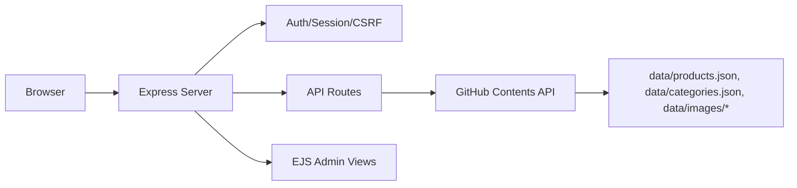

# VARNAM BANGLES

VARNAM BANGLES is a storefront for bangles with a GitHub-backed admin panel for managing products, categories, and images.

## Project overview

The application has two parts:

- A public static storefront (`index.html`, `product.html`, etc.) that reads product data from `/api/products`.
- A server-rendered admin panel (`/admin`) backed by Express, with session-based authentication and GitHub-backed JSON storage.

Product and category data are stored as JSON files in a GitHub repository through the GitHub Contents API. Product images are uploaded through an authenticated endpoint and stored as files in the same repository, with their resulting raw URLs saved in product records.

## Features implemented

### Storefront
- Product listing and product detail pages
- Category browsing
- Contact and story pages
- Data loaded from `/api/products` and `/api/categories`

### Admin panel
- Session-based admin login/logout
- Product CRUD (`/api/products`, `/api/products/:id`)
- Category management (`/api/categories`, `/api/categories/:key`)
- Product fields: id, slug, name, description, price, original price, images, category, material, sizes, colour/colours, stock status, availability, published, featured, bestseller, Meesho URL
- Image upload endpoint with validation (`/api/upload`)
- CSRF protection on write routes
- Rate limiting on login and write routes
- Mobile navigation toggle in admin layout

### Persistence
- Products stored in `data/products.json` in GitHub
- Categories stored in `data/categories.json` in GitHub
- Images stored under `data/images/<productId>/` in GitHub
- SHA-based updates with 409 conflict retry

## Technology stack

- Node.js (>=20)
- Express 4
- EJS templates
- express-session, cookie-parser, bcryptjs
- express-validator
- helmet
- express-rate-limit
- dotenv
- GitHub Contents API (fetch-based client)
- Vanilla JavaScript, HTML, CSS

## Architecture and data flow



## Repository structure

```
server/
  index.js          Express app entry point
  auth.js           Authentication, sessions, CSRF, rate limits
  github.js         GitHub Contents API client
  store.js          Product/category load/save helpers
  routes/api.js     Public and protected API routes
  views/            EJS templates
public/
  css/              Admin and storefront styles
  js/               Client-side scripts
test/               Node test files
data/               Local fallback data (where present)
```

## Prerequisites

- Node.js >= 20
- npm
- A GitHub repository and personal access token with contents read/write
- Admin email and bcrypt password hash

## Installation and local setup

```bash
npm install
cp .env.example .env
# Edit .env with your values
npm run dev
```

## Environment variables

See `.env.example`. Required variables include:

- `GITHUB_TOKEN` — GitHub personal access token (repo contents read/write)
- `GITHUB_OWNER` — Repository owner
- `GITHUB_REPO` — Repository name
- `GITHUB_BRANCH` — Branch (default `main`)
- `SESSION_SECRET` — Session signing secret
- `SESSION_NAME` — Session cookie name
- `SESSION_MAX_AGE_MS` — Session lifetime in ms
- `ADMIN_EMAIL` — Admin login email
- `ADMIN_PASSWORD_HASH` — bcrypt hash of admin password
- `NODE_ENV` — `development` or `production`
- `PORT` — Server port (default 3000)
- `DATA_CACHE_TTL_MS` — Cache TTL in ms

## Development and production run commands

```bash
npm run dev     # development
npm start       # production
npm run lint    # lint
npm test        # tests
```

## API overview

Public:
- `GET /api/products`
- `GET /api/products/:id`
- `GET /api/categories`

Protected (require auth + CSRF):
- `POST /api/products`
- `PUT /api/products/:id`
- `DELETE /api/products/:id`
- `POST /api/categories`
- `PUT /api/categories/:key`
- `DELETE /api/categories/:key`
- `POST /api/upload`

Auth:
- `POST /admin/login`
- `POST /admin/logout`
- `GET /admin/session`

## GitHub-based storage architecture

- `server/store.js` loads/saves `data/products.json` and `data/categories.json` via `server/github.js`.
- `uploadFile` in `server/github.js` writes base64-encoded file content to a path in the repo and returns a raw GitHub URL.
- The `/api/upload` endpoint validates product ID, file names, MIME types (JPEG/PNG/WebP), and size (max 1 MB per file), then uploads and returns URLs.
- Existing URL-based product images remain supported because `images` is an array of strings.

## Deployment

No deployment configuration is included in the repository. Deploy as a standard Node.js application on a host that supports environment variables, and set all variables from `.env.example`. Ensure the GitHub token has contents read/write permissions.

## Security considerations

- GitHub token and admin credentials stay server-side only.
- Admin routes require authentication.
- Write routes require CSRF tokens.
- Uploads validate type and size server-side.
- Helmet CSP and CORS configured in `server/index.js`.
- Do not commit `.env`.

## Troubleshooting

- If GitHub writes fail, verify `GITHUB_TOKEN`, owner, repo, and branch.
- If admin login fails, verify `ADMIN_EMAIL` and bcrypt hash.
- If uploads fail, check file type/size limits (JPEG/PNG/WebP, <= 1 MB).

## Future enhancements

- Image size limit increase and configurable limits may be adjusted.
- Additional validation or storage providers are not configured.

## License

No license file is present in the repository. License terms are not specified.
